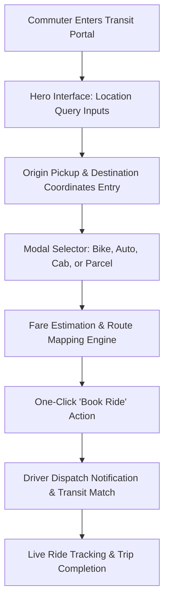

<div align="center">


[](https://developer.mozilla.org/en-US/docs/Web/HTML)
[](https://developer.mozilla.org/en-US/docs/Web/CSS)
[](https://developer.mozilla.org/en-US/docs/Web/JavaScript)
[](#)
[](#)

</div>

---

## 📌 Executive Summary / Overview

**Rapido FSD Transit Portal** (`Rapido_FSD`) is a full-stack web engineering simulation inspired by India's premier bike-taxi and transit ecosystem, Rapido ("Bharat Moves On Rapido!"). Developed during Full Stack Development (FSD) coursework, this application establishes a clean, high-conversion consumer interface for commuter on-demand transit booking.

Urban mobility requires friction-free dispatch UX: immediate geolocation input, instant vehicle modality selection (Bike, Auto, Cab, Parcel Courier), and dynamic fare transparency. This repository implements semantic HTML5 structuring, modular CSS layouts (`Rapido.css`), and an intuitive dispatch booking interface engineered for cross-device responsiveness.

---

## 📖 Interactive Table of Contents

- [Executive Summary / Overview](#-executive-summary--overview)
- [Key Features & Capabilities](#-key-features--capabilities)
- [System Architecture & Ride Booking Flow](#-system-architecture--ride-booking-flow)
- [Tech Stack Breakdown](#-tech-stack-breakdown)
- [Transit Modalities & Service Matrix](#-transit-modalities--service-matrix)
- [Reproducible Quickstart & Setup](#-reproducible-quickstart--setup)
- [Project Directory Layout](#-project-directory-layout)
- [Author & Contributions](#-author--contributions)

---

## ✨ Key Features & Capabilities

- **Frictionless Ride Dispatch Form**: High-visibility origin pickup and destination dropoff location input fields with one-click ride confirmation triggers.
- **Multimodal Fleet Category Selector**: Interactive vehicle classification showcase featuring Rapido Bike-Taxi, Rapido Auto, Economy/Comfort Cabs, and On-Demand Parcel Delivery.
- **Value Proposition Storytelling**: Branded hero banner and value cards articulating low fare guarantees, driver-partner proximity, and commuter safety protocols.
- **Modern Navigation Architecture**: Semantic top navigation linking company background, advertising solutions (Rapido Ads), passenger safety charters, and customer support.
- **Modular Semantic Styling**: Decoupled HTML markup and stylesheet properties providing a foundation for scalable component expansions.

---

## 🏗️ System Architecture & Ride Booking Flow



---

## 🛠️ Tech Stack Breakdown

| Category | Technologies & Tools |
| :--- | :--- |
| **Markup Language** | HTML5 (Semantic Structure, Meta Viewports, Forms) |
| **Styling & Design** | CSS3 (Flexbox, Hero Overlays, Typography, Transitions) |
| **Client-Side Logic**| JavaScript (Form Validation, Input Handling) |
| **Development Platform** | Modern Web Browsers (Chrome, Edge, Firefox), VS Code |

---

## 🛵 Transit Modalities & Service Matrix

| Transit Tier | Modality | Primary Commuter Use Case | Key Value Proposition |
| :--- | :--- | :--- | :--- |
| **Rapido Bike** | Two-Wheeler | Solo intra-city urban commuting & rush-hour transit | Beat dense traffic at ultra-low fares |
| **Rapido Auto** | Three-Wheeler | Door-to-door transit for 1–3 passengers | Meter-free, zero bargaining, direct booking |
| **Rapido Cab** | Four-Wheeler | Comfort and weather-protected city journeys | AC ride comfort at competitive fixed prices |
| **Rapido Parcel** | Delivery Fleet | Hyperlocal peer-to-peer package logistics | Same-day instant pickup and delivery |

---

## 🚀 Reproducible Quickstart & Setup

### Prerequisites
- Modern web browser (Google Chrome, Mozilla Firefox, Microsoft Edge, Safari)

### Step 1: Clone the Repository
```bash
git clone https://github.com/Jeshwanthika07/Rapido_FSD.git
cd Rapido_FSD
```

### Step 2: Launch the Web Portal
Simply open `rapidoupdated.html` directly in your default browser:
```bash
# On Windows
start rapidoupdated.html

# On macOS
open rapidoupdated.html

# On Linux
xdg-open rapidoupdated.html
```
Alternatively, launch with VS Code Live Server extension at `http://127.0.0.1:5500/rapidoupdated.html`.

---

## 📂 Project Directory Layout

```text
Rapido_FSD/
│
├── rapidoupdated.html         # Primary ride dispatch web page & structure
├── Rapido.css                 # Transit styling and responsive layout rules
└── README.md                  # Comprehensive technical documentation
```

---

## 👩‍💻 Author & Contributions

Authored by **[Jeshwanthika Pothamchetty](https://github.com/Jeshwanthika07)**  
*Alliance University | Department of Computer Applications*

<div align="center">


</div>
